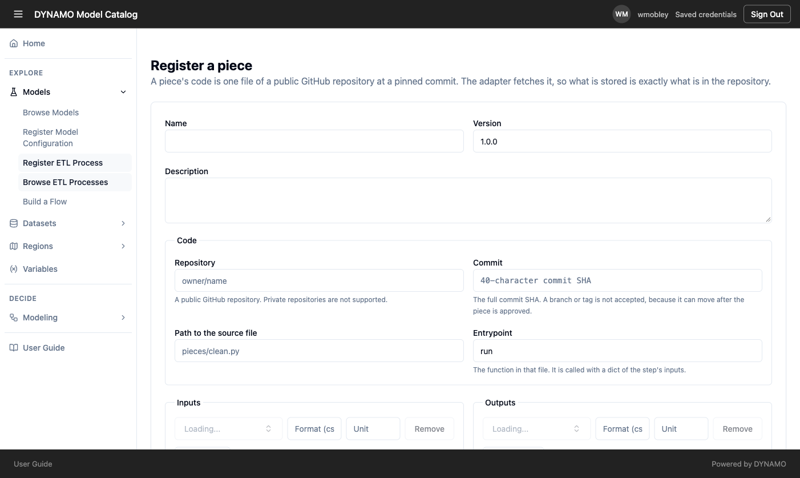
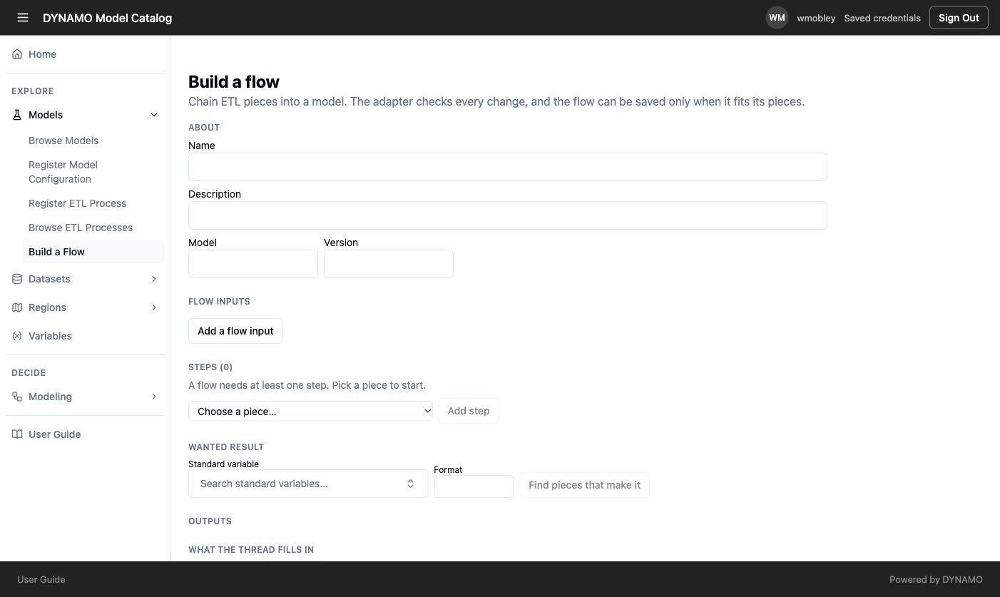

# Build a flow and register a piece

A **flow** is a model made of linked **pieces**. A piece is one step of work: a function in a file in a public GitHub repository, with a stated list of inputs, outputs, arguments and the data it sends out. You can register a piece from a commit, and then link pieces in the flow builder to make a flow.

Both tasks need you to be signed in. A piece you register is private to you until you share it. A shared or public piece runs for other people only after an administrator approves it.

## Register a piece from a commit

Open **Models → Register a piece from GitHub**, or select **Register a piece** on the ETL processes page. The piece form is for pieces whose code lives in a GitHub commit.

<!-- To confirm before publishing: this page is not linked from the sidebar, which has "Register ETL Process" (/etl/register) for the older registration form. Say here how a user reaches this page once a link exists. -->

Fill in the form. Each field below is named as the form names it.

**Code**

- **Name** and **Version**. The name people will see. Raise the version whenever the code changes.
- **Description**. What the piece does, in plain words.
- **Repository**. A public GitHub repository, as `owner/name`. Private repositories are not supported.
- **Commit**. The full 40-character commit SHA. A branch or a tag is not accepted, because it can move after the piece is approved.
- **Path to the source file**. For example, `pieces/clean.py`.
- **Entrypoint**. The function in that file. DYNAMO calls it with a dict of the step's inputs.

**Inputs and outputs**

Each input and each output is a row of three things: a **standard variable**, a **format** such as `csv`, `netcdf` or `directory`, and a **unit**. The adapter uses them to decide which pieces and data fit together, so use the same standard variables as your datasets and models. Select **Add input** or **Add output** for more rows. A row can be removed only while there is more than one.

**Run arguments**

Each argument has a name, a type, a default, a description, and a *required* tick. The function receives each argument as a task input, named in capitals.

**Secrets the piece needs**

A secret is a saved credential the piece uses at run time. Each line maps one of the piece's task inputs to one field of the secret, in the form `INPUT_NAME=field`, for example `OPENAI_API_KEY=api_key`. The person who runs the flow supplies their own stored secret. See [Saved credentials](../saved-credentials.md).

**Data sent outside DYNAMO**

For each outside service the code sends data to, give the service and what is sent. An approver reads this before approving the piece, so be specific.

**Visibility**

- **private**: only you can run it.
- **shared** or **public**: others can run it, but only after an administrator approves it.

### Preview, then register

1. Select **Preview**. DYNAMO checks the form and shows a panel titled *What will be stored*. Nothing is saved yet.
2. Fix anything it flags, then select **Register this piece**.

After it registers, the page shows the piece's ID. For a shared or public piece it adds *It needs approval before others can run it*, with a link to **Open its approval page**.

### Where the code came from

The approval page says where the commit was found. It shows either *verified in [repository]'s [branch] history*, when GitHub confirms the commit is in a branch's history, or *UNVERIFIED — read the source*. Read the source yourself when it says unverified.

When you register, DYNAMO checks with GitHub that the commit is in the history of the
repository's main branch. A commit that exists only in a fork or on a side branch is
refused. You can make up to 30 registration requests an hour, previews included, and
own up to 200 pieces.

## Approval

Only catalog administrators approve or withdraw a piece. Everyone else can read the approval pages.

- `/etl/approvals` lists the shared and public pieces. Those waiting for approval come first, then those already approved.
- `/etl/approvals/[id]` shows one piece: its code, its origin, its data destinations, and its approval history. An administrator can select **Approve this piece** and confirm. The page shows a hash of the code, and the approval is for that hash.

A private piece runs only for its owner, so it has nothing to approve.

## Build a flow

Open **Models → Build a Flow**, or go to `/flows/new`. To start from an existing flow, open it and select **Edit as a copy**, or go to `/flows/new/[id]`.

The form builds the flow as you go. A live check runs on every change and reports problems on the step or link they belong to. **Save flow** stays off until every part of the form is complete and the check passes for exactly what is on the form.

The form has these parts, in order.

1. **About**. The flow's **Name** and **Description**.
2. **Flow inputs**. Add each one with **Add a flow input**. Each input has a name, a label, a standard variable, a format, and two ticks: **Optional**, and **Takes a collection of files**. A collection input is read together as one input, so a run uses all the files chosen for it. See [Run a flow](../facilitator/run-a-flow.md).
3. **Wanted result**. The standard variable and format the flow should produce. **Find pieces that make it** suggests pieces and chains of pieces that can produce it, with a note on each saying whether every input has a source.
4. **Steps**. Add steps with **Add step**. A flow needs at least one step. Pick a piece for each step and connect its inputs to the flow's inputs or to earlier steps' outputs. Tick **Pause for review after this step** to make the run stop after that step so a person can edit its output. See [When a flow pauses for your edit](../facilitator/run-a-flow.md#when-a-flow-pauses-for-your-edit).
5. **Outputs**. Add the outputs the flow reports, with **Add output**.
6. **What the thread fills in**. The settings the flow takes from the thread. A value that is fixed here is shown to the person who runs the flow. Which inputs take a collection is set on each input above.
7. **Graph**. The steps and their links, drawn as a picture.
8. **Check and save**. Shows *Checking…* while the check runs. If the check cannot run, the form says *The check could not be run, so it cannot be saved*.

### Save

Select **Save flow**. The form confirms *Saved as a new configuration under the same version*, with a link to **Open the new flow**.

<!-- To confirm before publishing: the brief said the form cannot yet choose which file a new pause makes editable. That limit is not visible in the form code, so confirm it with the maintainers before you publish it. -->

## Next steps

- [Register a model](register-model.md) if your flow should appear as a model in the catalog.
- [Upload a dataset](upload-a-dataset.md) to give a flow data to read.
