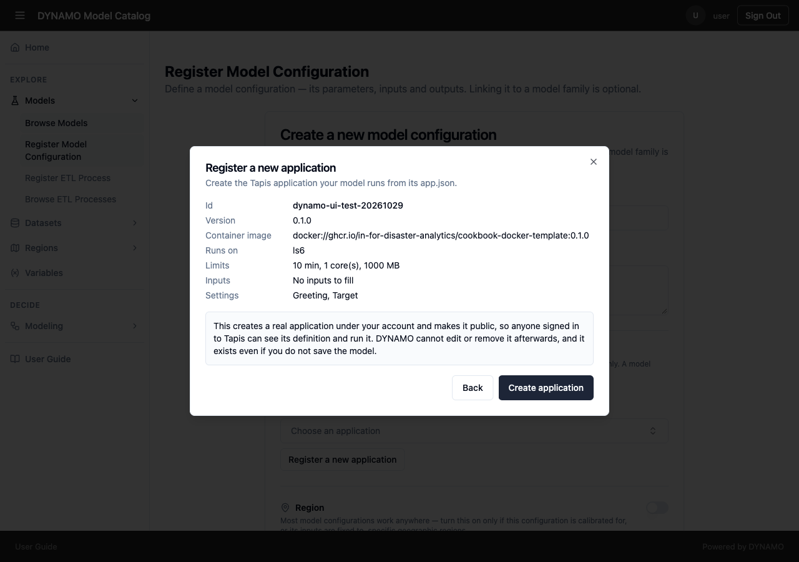
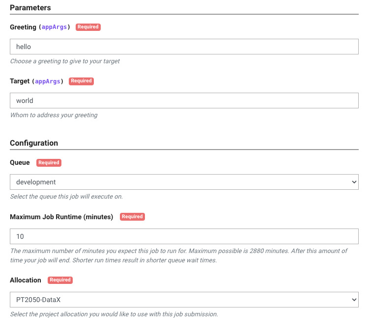
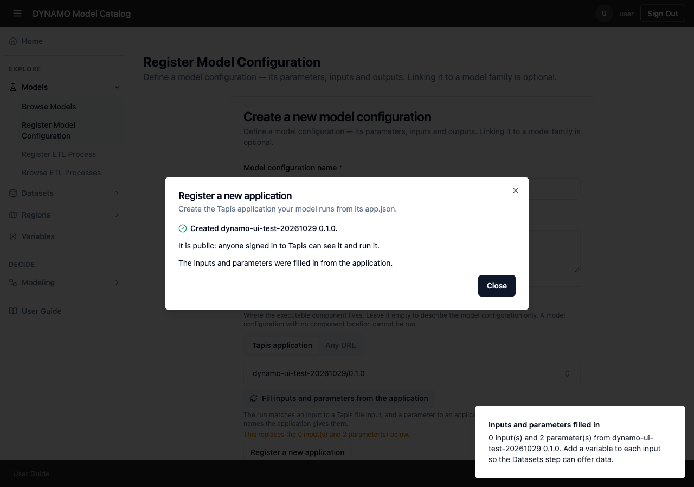

# Make a model runnable: publish a cookbook

DYNAMO can only run a model that has been packaged as a **cookbook**: a small application that runs on TACC's computers without anyone watching. Publishing a cookbook gives you three things: your model packaged with everything it needs, a description of what it takes in and what settings it has, and a listing that DYNAMO can use. You then register that listing as a model, so facilitators can find and run it.

Do this before you [register the model](register-model.md). Without a cookbook, a model can be described but not run.

## Choose a template

TACC provides ready-made templates. Pick the one that matches how your model runs, then replace the example with your own.

| Template | Use it when | What DYNAMO makes of it |
|---|---|---|
| [Command template](https://github.com/In-For-Disaster-Analytics/Cookbook-Docker-Template) | Your model runs from a command, and people choose a few typed settings, such as a name or a number | Each setting becomes a model **parameter** |
| [Python and conda template](https://github.com/In-For-Disaster-Analytics/Cookbook-Conda-Template) | Your model is a Python script that reads input files and writes results, and needs particular packages | Each input file becomes a model **input** |

If your model needs both input files and settings, start from the Python and conda template and add settings as in the command template.

A third template, the [Jupyter template](https://github.com/In-For-Disaster-Analytics/Cookbook-Jupyter-Template), opens an interactive notebook session for a person to work in. DYNAMO runs a model for you and collects its results, so that template is for a different job and is not the one to use here.

## What you need first

- A **GitHub account**, to hold your copy of the template.
- A **TACC account**. You can [request one](https://accounts.tacc.utexas.edu/register).
- A TACC **allocation**, which is the computing time your runs are charged to. Without one, your runs will not start. Check your [approved allocations](https://ptdatax.tacc.utexas.edu/workbench/allocations/approved), or [request one](https://portal.tacc.utexas.edu/allocation-request).

## Publish your cookbook

1. **Create your own copy.** Open the template on GitHub and select **Use this template**. Name the new repository after your model, so you can find it again.
2. **Put your model in it.** Replace the example with your own code.
    - *Python and conda template:* replace the example script, list the packages your model needs in `environment.yaml`, and edit `run.sh` to run your script. Your input files are placed in an input folder, and your script must write its results to the output folder. TACC sets both for you, and the output folder is what the job's **Output location** shows, so write your results there.
    - *Command template:* edit `run.sh` to run your model. The settings people choose reach your command as arguments, in the order they are listed in the app description.
3. **Package it.** Build a container image, which is a packaged copy of your model and everything it needs, and push it to a registry that TACC can reach. The template's `README` gives the exact commands. Pin the version of each package, as the template does, so the same cookbook gives the same answer next year.
4. **Describe it in `app.json`.** This file is the description of your cookbook, and the next steps rely on it. Change:
    - **id:** a unique name. This is the name people choose from a list in DYNAMO, so make it recognisable. Do not change it later, because anything that refers to it breaks.
    - **version:** raise it every time you change the model, so earlier results stay reproducible.
    - **description:** say what the model does, for someone who has never seen it.
    - **containerImage:** the image you pushed in step 3.
    - **Inputs and settings:** give each input file and each setting a clear name and description, and say which are required. DYNAMO copies these into the model's inputs and parameters, so write them for a facilitator, not for yourself.
    - **Time, memory and cores:** the template starts at 10 minutes, 1 core and 1000 MB. Raise them to what a real run needs, because a run that reaches its limit is stopped and fails.
5. **Create the application.** You can do this without leaving DYNAMO. Open **Models → Register Model Configuration**, find **Component location**, and with **Tapis application** selected choose **Register a new application**. Upload your `app.json`, or paste its contents, then select **Review**. DYNAMO shows what it will create: the id and version, the container image, where it runs, its time, core and memory limits, and its input files and settings. Fix anything it flags, then select **Create application**.

    

    Read the notice before you confirm. Creating the application makes a real application under your account **and makes it public**, so anyone signed in to Tapis can see its definition and run it. DYNAMO cannot edit it, remove it or make it private afterwards. Only you or a Tapis administrator can, in Tapis. The application exists even if you never save the model. Never put a password or key in the definition, because everyone can read it.

    Before it sends anything, DYNAMO checks that the image has a version tag (not `:latest`), that the id and version contain no `/`, and that every input and setting has a name. If you prefer, you can create the application in the [Cookbook UI](https://in-for-disaster-analytics.github.io/cookbooks-ui/#/apps) with **Create Application** instead, and then choose it in the form.
6. **Test it before you register it.** On the application's page select **Run**. Choose your input file or settings, then choose the **Queue**, the **Maximum Job Runtime** and your **Allocation**, and submit. When the job shows **Finished**, open its **Output location** and check the files are what you expect.

Test with a small sample first. Fixing a mistake now is far quicker than finding it after facilitators have started using the model. The screenshot shows the command template's example settings, and the layout can change between releases.

## Finish registering the model

When the application is created, DYNAMO selects it in the form and offers to fill in the inputs and settings from it. If your form already has some, it asks whether to replace them or keep yours.

Back in **Models → Register Model Configuration**:

1. If you created the application in the Cookbook UI instead, choose it from the **Tapis application** list. The list shows every application you can use: your own, those shared with you, and public ones.
2. Check the inputs and settings the form filled in from your `app.json`.
3. Add a **standard variable and unit** to each input, so DYNAMO can offer data for it. Then add the model's **outputs** yourself, with their variables, because the application does not declare them.
4. Complete the rest of the form as described in [Register a model](register-model.md).

Then try it as a facilitator would: start a task, choose your model, give each input a dataset, and run it.

If your application is missing from the list, or something goes wrong while creating it, see [Troubleshooting](../troubleshooting.md).
