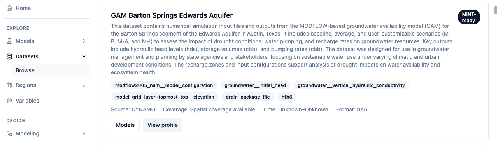

# Register data

You can add a dataset yourself, from **Datasets → Upload a dataset**. The form asks for the same details listed below, and [Upload a dataset](upload-a-dataset.md) explains each field. Datasets you cannot upload this way are added through your organisation's data catalog. In that case, ask your data catalog administrator to publish the dataset, and give them the details below. These details decide whether people can find your data and match it to a model, so send them together with the files.

For each file, provide:

- **What it measures.** One or more standard variables, from the [Variables](../discovery.md#look-up-a-variable) page. Without a variable the file cannot be matched to a model input, and it will not appear in DYNAMO at all.
- **The unit** each variable is measured in, so people can tell the data fits the model.
- **The file format.** An unrecognised or missing format can make a file look usable when it is not.
- **Where and when it applies.** Give the area it covers and the time range, so people can filter to data that fits their place and period.
- **Where it came from and who may use it.** State the source and license, so users can judge whether to trust and reuse it.
- **A description.** Say what the data contains and what it is for, in plain words.

If a file holds several variables, list all of them. Each one you list lets the data match another model input.

## Check it appeared

If you uploaded the dataset on the upload page, that page reads it back from the catalog and shows **Open the dataset page**. Otherwise, open **Datasets → Browse** and search for your dataset to confirm it is there.
<!-- To confirm before publishing: the original guide said new data is not visible until the catalog is refreshed, and that an administrator must arrange it. Check this against the current catalog before keeping the sentence below. -->
New data that an administrator publishes may not be visible straight away. If it is missing, ask your administrator to refresh the catalog.

Check the card against what you supplied. The tags are your standard variables, and they are what let DYNAMO offer the dataset for a model input. If a tag is missing, the dataset will not be offered for that input, so ask your administrator to correct it. See [Why the details you enter matter](../reference/why-metadata.md).
