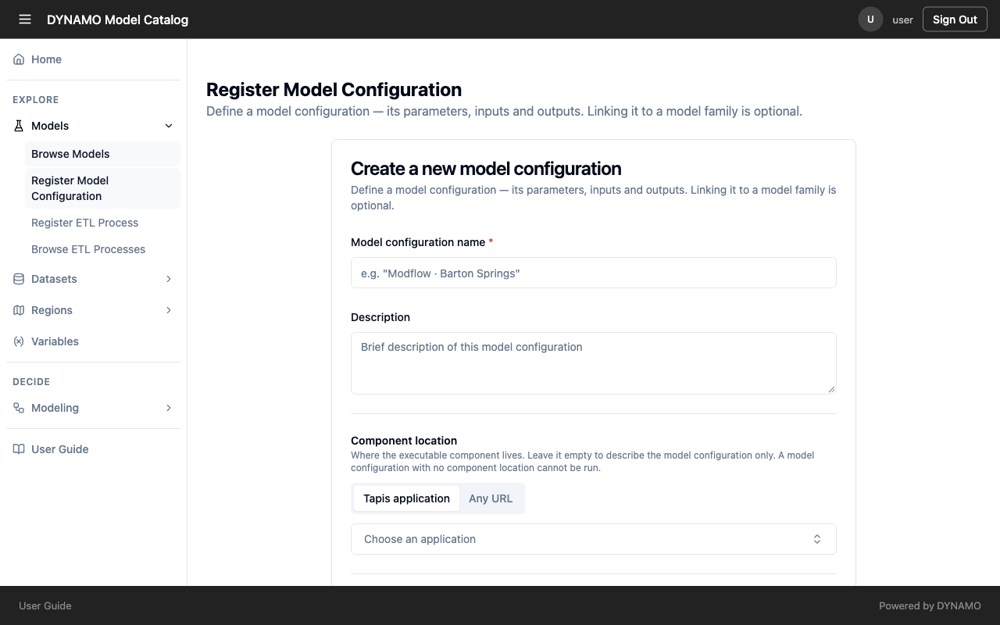
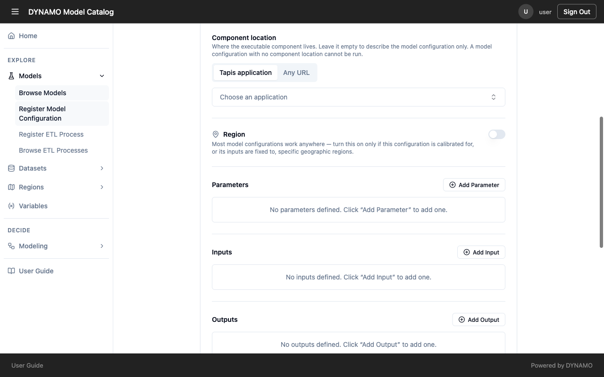
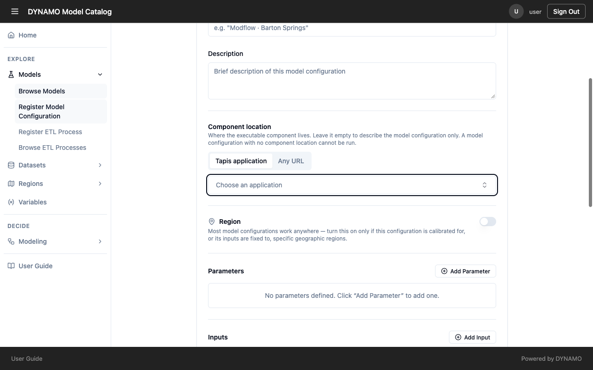
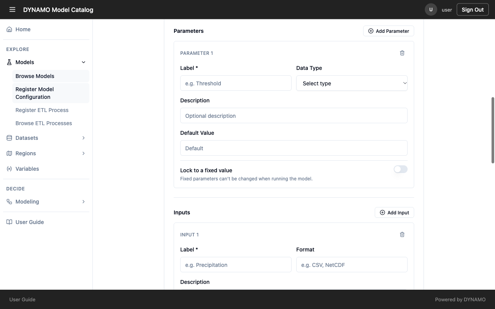
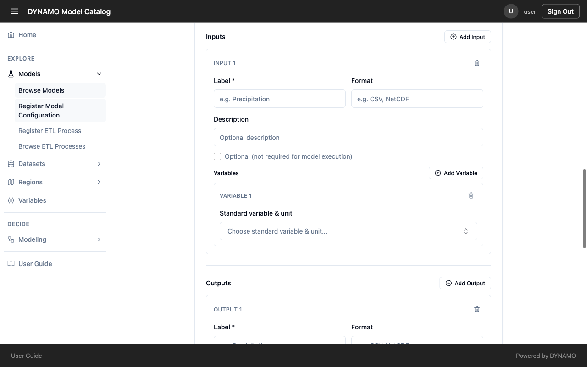
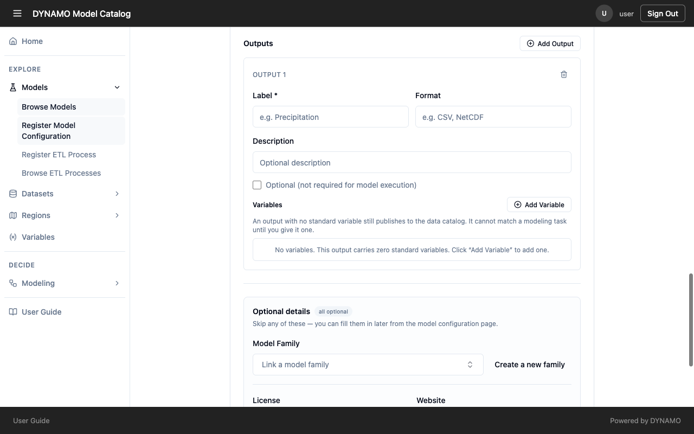
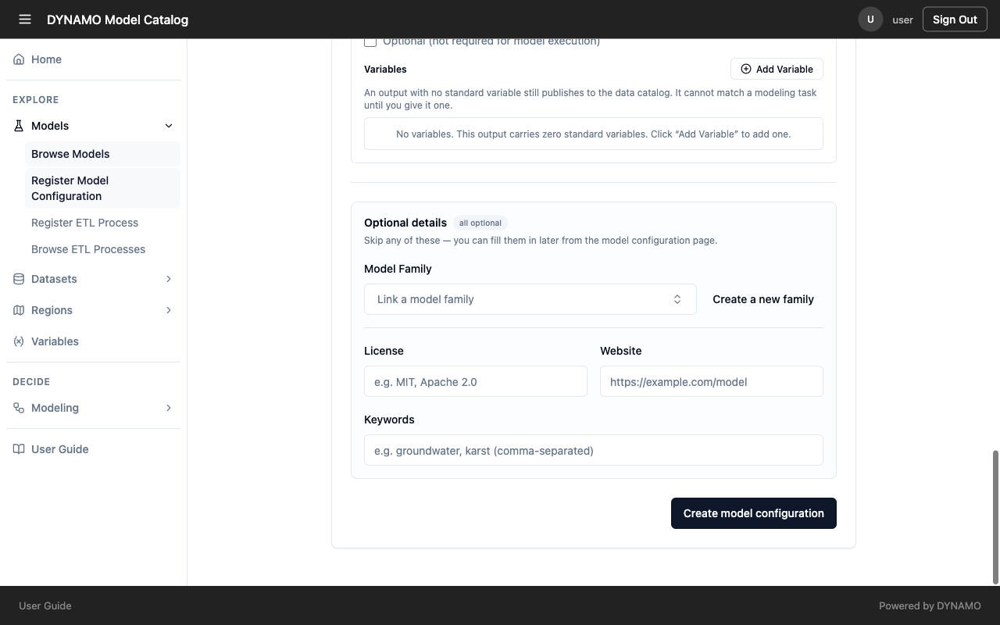

# Register a model

Registering a model creates the entry people find, compare and run. The form is short, but each section decides whether your model is found and used correctly. Read [Why the details you enter matter](../reference/why-metadata.md) if you have not already.

Open **Models → Register Model Configuration**. You must be signed in. Registering adds a *description* of your model. The model itself stays where the component location points.

## Name and description

Enter a name (required) that someone would recognise next to similar models, with the place or purpose in it, such as "Modflow · Barton Springs" rather than "config2". In the description, say what the configuration is for, where it is calibrated, and what it produces. People read these two fields in the model list before they open anything, so they decide whether your model is even considered.

## Component location

Choose where the model runs: a **Tapis application** (the platform that runs models for DYNAMO) or **Any URL**. You can leave it empty to describe the model only, but **a configuration with no component location cannot be run**, so people will find it and then be unable to use it.

When you choose an application, the form fills in its inputs and settings for you. Check them, then add a variable to each input so DYNAMO can offer data for it.

## Region

Leave this off unless it matters. Most models work anywhere. Turn it on only if the model is calibrated for, or its inputs are fixed to, specific regions. People can filter models by region, so a limited model is then offered only where it applies. Turning it on for a model that works anywhere can keep it from people working elsewhere.

## Parameters

Parameters are the settings a person chooses when they run the model. For each one, enter a label, a data type (text, whole number, decimal, true/false, web address or date and time), a description and a default. Use **Lock to a fixed value** when the model must not be changed at run time, because a locked value cannot be overridden. A clear description lets a facilitator choose a sensible value without asking you.

## Inputs and outputs

For each input and output, enter a label, a format such as CSV or NetCDF, and a description. Tick **Optional** for an input the model can run without. Then add its variable.

Choosing the **standard variable and unit** is the most important step on this page.

- On an **input**, it tells DYNAMO what data to offer. Without it, nothing can be matched.
- On an **output**, it tells DYNAMO what question the model answers. The form states that an output with no variable is still published but cannot match a modeling task until you give it one.

Search for the variable by what the data *is*, then pick the unit. Be exact about the unit and the format: data with the right variable but the wrong unit or format looks like a match and then fails or gives wrong numbers.

## Optional details

Model family, license, website and keywords are optional.

Link a **model family** when one exists, so versions of the same model sit together and do not look like unrelated models. The form accepts a license, website and keywords, but these are not yet saved for a new configuration, so for now put anything people need to know, such as the license or a link, in the description.

## Before you submit

1. Does the name make sense on its own?
2. Does the component location point to a model that can run?
3. Does every input and output that matters have a variable, unit and format?
4. Did you limit the region only if the model truly is limited?

Select **Create model configuration**. Then open **Models → Browse Models**, turn on **My models**, and check that your model's inputs and outputs read the way you intended.
