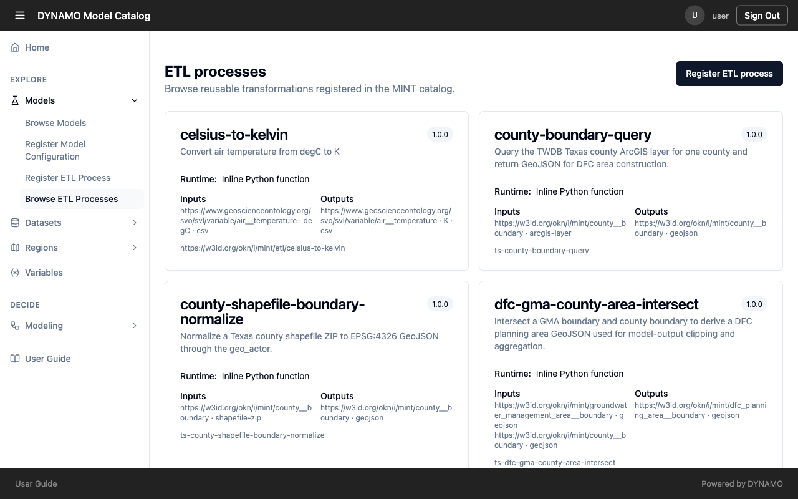
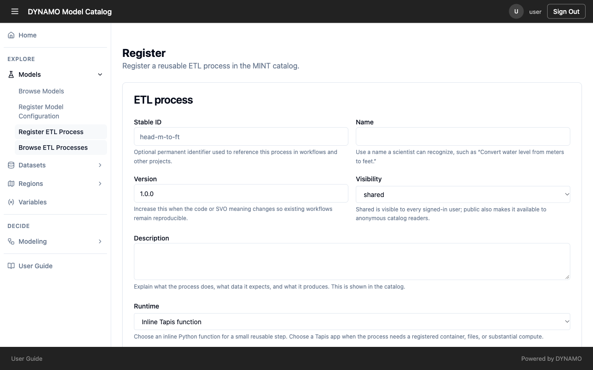
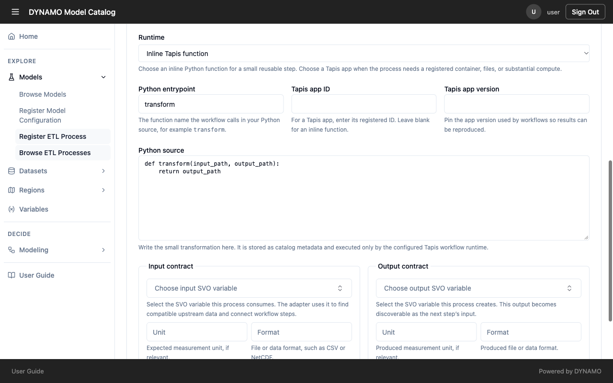
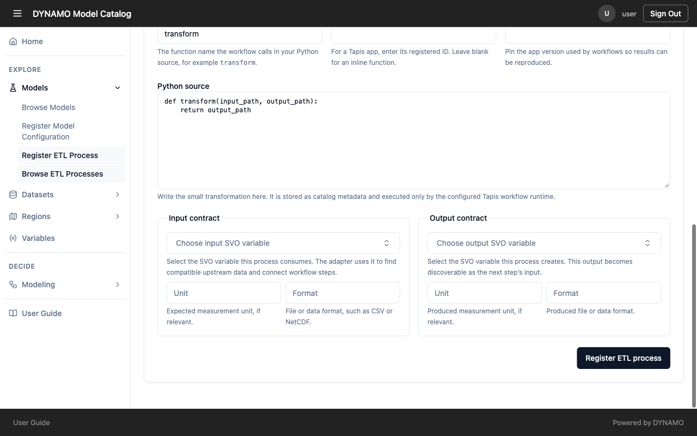

# Connect resources with transformations

A transformation is a reusable step that converts data from one form into another, such as metres into feet, or a shapefile into a format a model can read. Registering one lets DYNAMO offer it automatically when a model needs data in a different form from what is available.

## See what already exists

Open **Models → Browse ETL Processes**. Each card shows the transformation's name, version, how it runs, and what it takes in and produces. Check here before you register a new one, so you reuse what exists.

## Register one

Open **Models → Register ETL Process**. You must be signed in.

Fill in the fields, and note why each matters:

- **Stable ID** (optional): a permanent identifier that other work uses to refer to this step. Choose one you will never need to change, because anything that refers to it breaks if it moves.
- **Name:** use a name a scientist would recognise, such as "Convert water level from meters to feet", not a code name.
- **Version:** raise it whenever the code or the meaning of the variables changes, so earlier results can still be reproduced.
- **Visibility:** *private* keeps it to you, *shared* shows it to every signed-in user, and *public* also shows it to people who are not signed in. A transformation nobody can see cannot be found, so choose the widest setting you are comfortable with.
- **Description:** say what it does, what data it expects and what it produces. It is shown in the catalog.

## How it runs

Choose **Inline Tapis function** for a small step you can write as a short function, or **Tapis app/job** when it needs a registered application, files or heavy computation. For a function, give the function name the step calls, such as `transform`, and enter the code. For an application, give its ID and pin the version, so results stay reproducible.

## What goes in and what comes out

This is the part that makes a transformation findable and chainable, so complete it carefully.

- Choose the **input variable** the step consumes. DYNAMO uses it to find data this step can work on.
- Choose the **output variable** the step produces. The form notes that this output becomes available as the next step's input, which is how steps join into a chain.
- Fill in the **unit** and **format** on both sides, so a step that expects CSV in metres is not offered NetCDF in feet.

If the variables are wrong or left out, the transformation registers but never shows up where people need it. Use the same standard variables as the models and datasets it connects. See [Why the details you enter matter](../reference/why-metadata.md).
