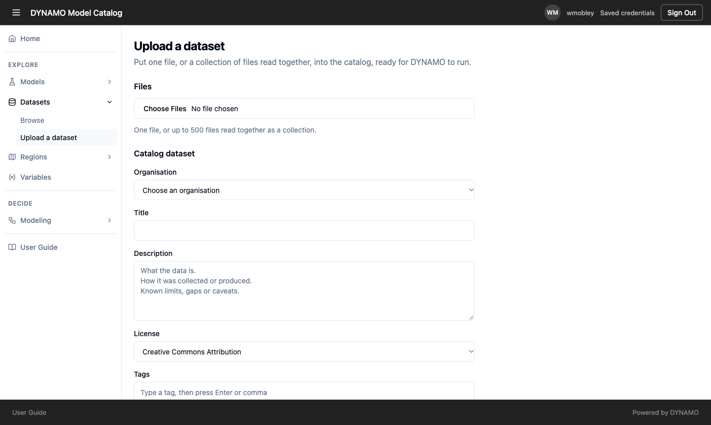
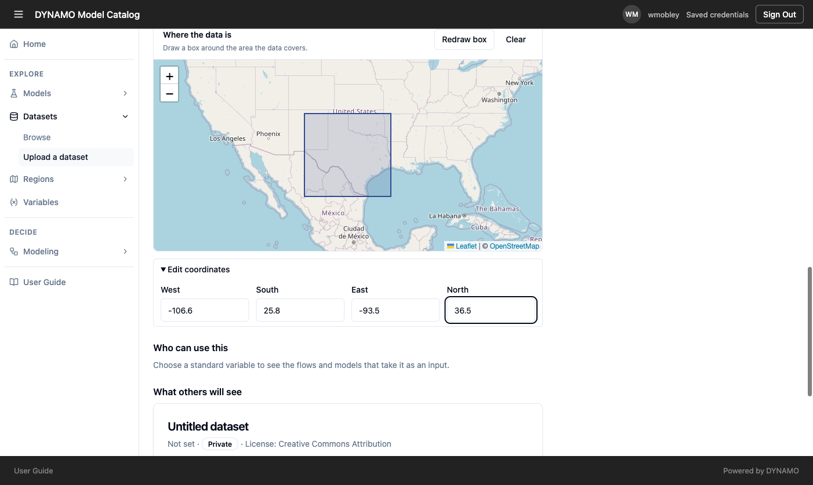

# Upload a dataset

You can put your own data into the catalog from DYNAMO, without asking an administrator to publish it. Choose one file, or a collection of files that are read together as one dataset. Once it is in the catalog, you can offer it to flows and models.

You must be signed in. Open **Datasets → Upload a dataset** in the menu, or go to `/datasets/upload`.

## What you can upload

- **One file**, or **up to 500 files** at once. The files are read together as one collection, and one standard variable applies to all of them.
- **2 GB in all** per upload.
- The file's format comes from its extension, such as `.csv` or `.nc`. If the files in a collection have different extensions, DYNAMO shows a warning. A collection is normally one format, so check before you upload.

The upload creates one new dataset in the catalog. It does not move your files anywhere else.

## Fill in the form

Work down the form. The items marked *required* must be filled in before **Upload** does anything. If something is missing, DYNAMO lists what to fix above the button.

### Files

Choose the file or files with **Choose files to upload**.

After you choose files, each file gets an optional **About [file name]** line. Write one line on what is in that file.

### Catalog dataset

- **Organisation** (required). Only organisations where you are allowed to create datasets are listed. If none is listed, DYNAMO says *You cannot create datasets in any catalog organisation*. Ask a catalog administrator to add you to one.
- **Title** (required).
- **Description**. Say what the data contains. If you leave it empty, the dataset gets a standard note that it was uploaded through the DYNAMO upload page.
  The description is required in this form. Include how the data was collected or produced, and any known limits or gaps.

- **License** (required). Choose the license the data is shared under. A default is selected when the list loads.
- **Tags**. Add as many as you need. They help people find the dataset.
- **Author**. Filled in with your username. Change it if someone else is the author.
- **Contact email** (optional). Checked for a valid address if you enter one.
- **Source or citation link** (optional). An address that starts with `https://`.
- **Version** (optional).

**Make public** is off by default, so the dataset is **private**. The form explains what that means:

> A model run reads its input files directly and can only read public files. A flow can read private files, because it runs with your access.

So:

- A private dataset can be read by members of its organisation and by your own runs. Use it for flows.
- A public dataset can be read by anyone. A model needs public data, so tick **Make public** if you want to use the data with a model.

### What makes it ready for DYNAMO

- **Standard variable** (required). Search for the variable that describes what the data *is*, not what the file is called.
  Its description and units are shown under the choice.
- **Start date** and **End date** (required). The start must not be after the end.
- **Spatial coverage**. Choose one of:
    - **No spatial area**.
    - **A MINT region**. Choose a category, then a region. The dataset takes the bounding box of that region's geometry. If the region has no geometry, DYNAMO asks you to choose another.
    - **A bounding box**.Draw a box on the map, or open **Edit coordinates** and type West, South, East and North in degrees.Without the map, type the four values in degrees. West must be below East, South below North, longitude between -180 and 180, latitude between -90 and 90.

### Who can use this

This section lists the flows and models that have an input for the standard variable you chose. For each one it says whether the format fits:

- *the format fits*
- *the format does not fit*, with the reason
- *reads [format]* or *any format*, when the format cannot be checked

If nothing is listed, no registered flow or model has an input for that variable yet. You can still upload the dataset.

### What others will see

A summary card shows the dataset as others will see it: its title, organisation, license, whether it is public, its dates, region or box, variable, tags, and each file with its format and description. Check it before you upload.

## Upload

Select **Upload**. A progress bar shows the percentage and which file is being sent. The button reads *Uploading…* until it finishes.

When the upload finishes, the page says **Dataset uploaded**, shows the dataset's ID, and says whether it is **Private** or **Public**. DYNAMO reads the dataset back from the catalog to check it before it says so.

From there you can:

- **Open the dataset page** to see the dataset as others see it.
- **Use in a thread** to go to your problem statements, and start a thread with the data.
- **Upload another** to start a new form.

## After you upload

- A flow can use the dataset from the Datasets step of a thread. Look for it when you search for the input's variable.
- A model can use it only if it is **public**. A private dataset will not work for a model's input.
- This page creates new datasets only. It does not edit or delete one.

<!-- To confirm before publishing: whether an uploaded dataset appears in Datasets → Browse straight away, or only after a catalog refresh. The old guide said a refresh was needed; the upload page reads the dataset back but the page does not say whether search is updated at once. -->

## Next steps

- [Register data](register-data.md): the details that make a dataset findable and matchable.
- [Find models and data](../discovery.md): see how other people will find your dataset.
- [Run a flow](../facilitator/run-a-flow.md): how a flow reads a collection.
