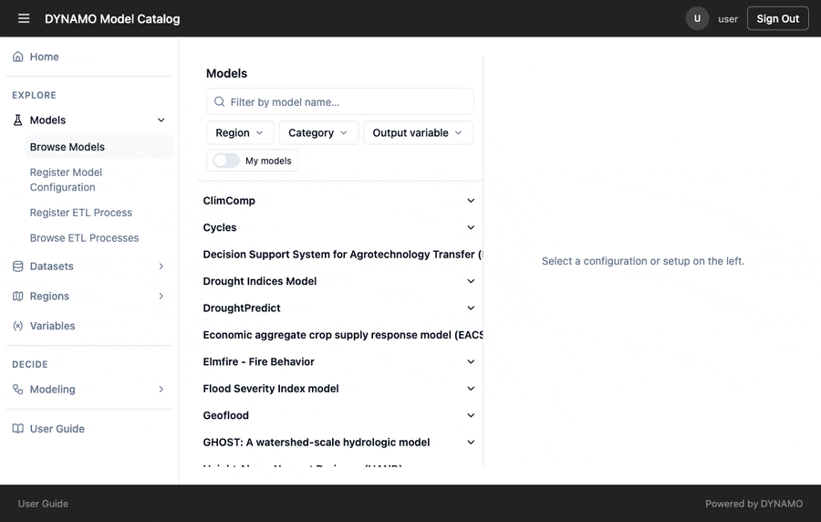
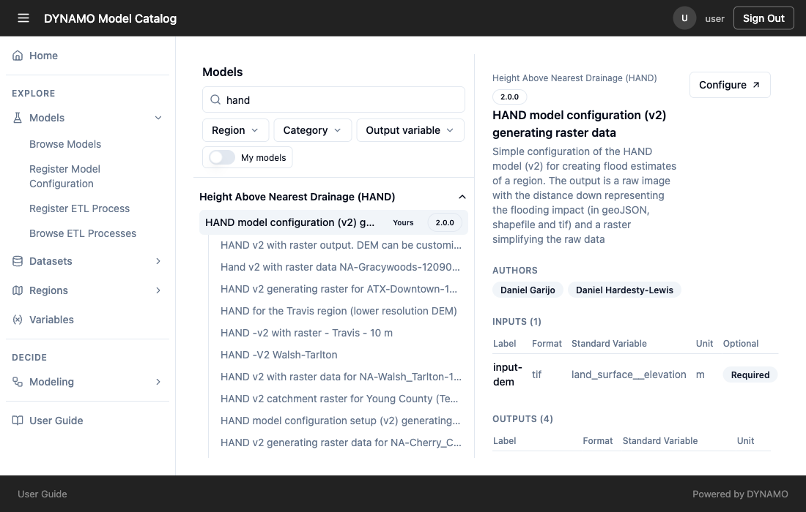
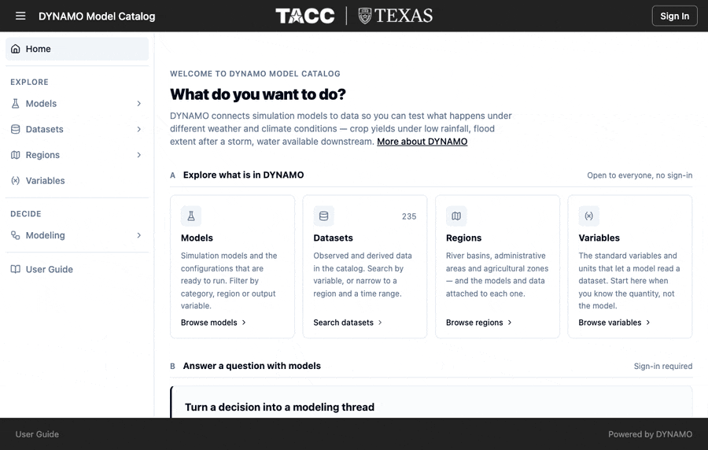
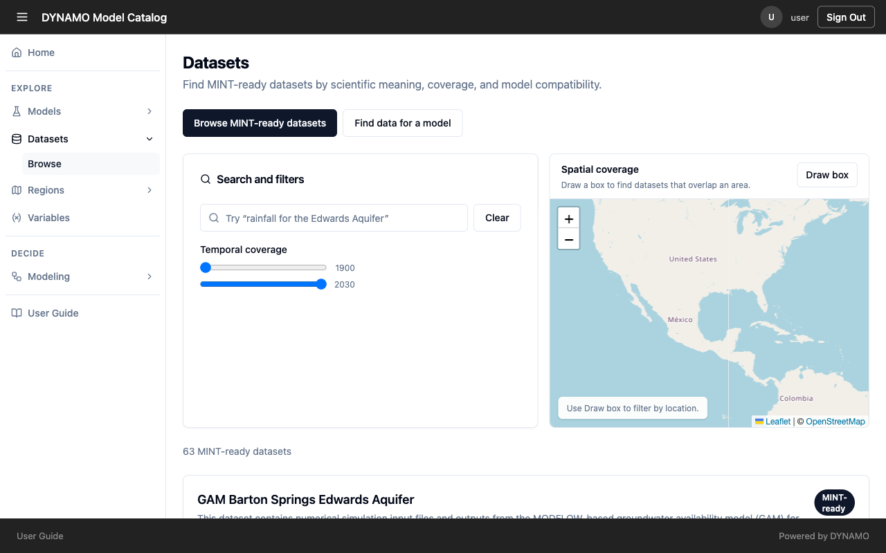
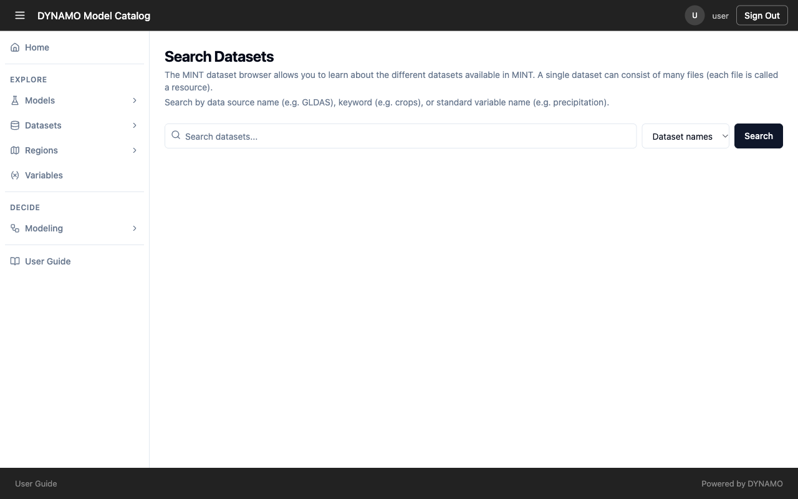
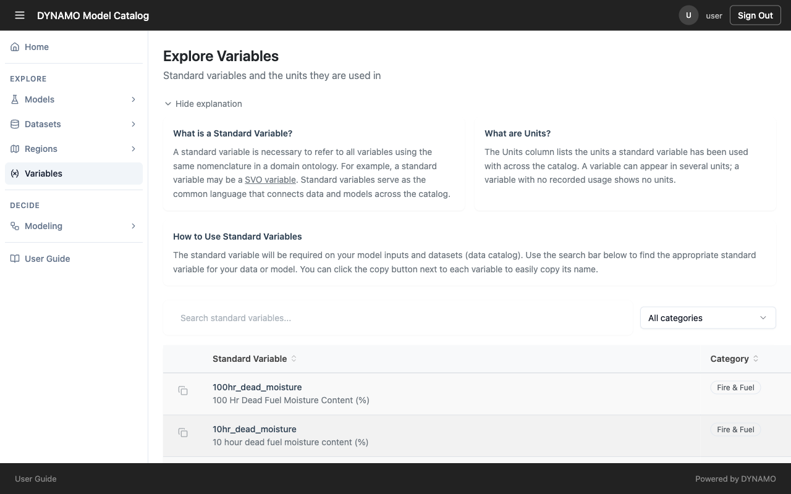
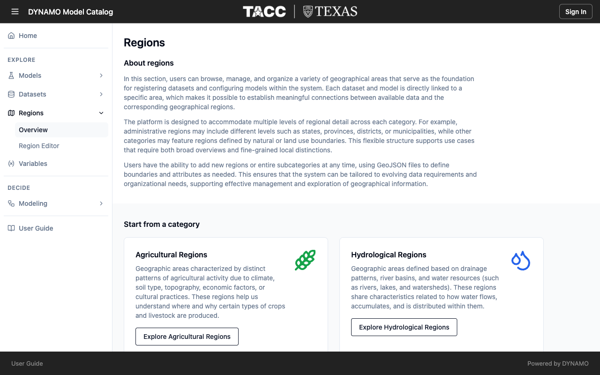
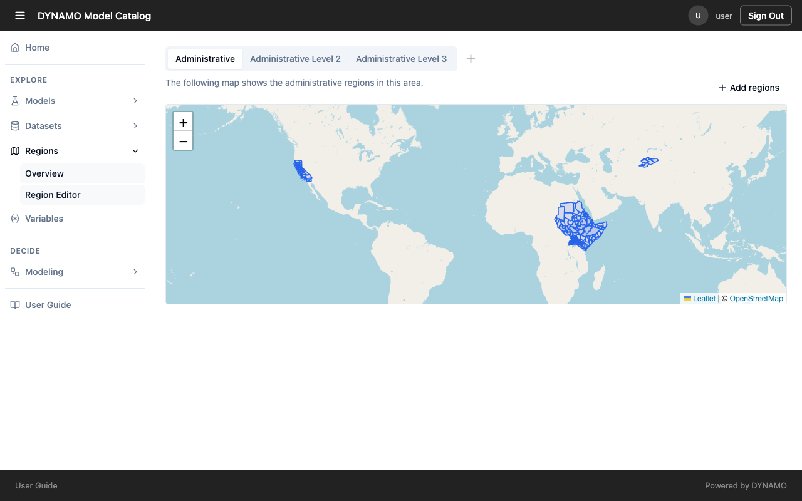

# Find models and data

Inspect a model’s scientific purpose, regional applicability, required inputs, produced outputs, parameters, and limitations. For each dataset, inspect its source, resources, variables, format, units, and spatial and temporal coverage.

A shared variable name is a useful discovery clue. Check the full input contract and coverage before assuming a dataset is ready for a model.

## Search for models

Open **Models → Browse Models**. Type part of a model name to filter the list, or narrow it with **Region**, **Category** and **Output variable**. Select a model to expand its configurations, then select a configuration to see its description, authors, inputs and outputs. Each input lists its format, standard variable, unit and whether it is required.

## Search for datasets

Open **Datasets → Browse**. Type a phrase such as "groundwater" into the search box, narrow the temporal range, or use **Draw box** on the map to keep only datasets that overlap an area. Browsing datasets does not require signing in.

## Search datasets by keyword or variable

**Datasets → Search Datasets** also finds data by source name, keyword or standard variable name. Results are only as good as the tags the data provider registered, which is why [registration metadata](reference/why-metadata.md) matters.

## Find a standard variable

**Variables** lists the standard variables that models and datasets share, with their category and units. Search by name or filter by category to find the variable that matches your data or model input.

## Browse by region

**Regions → Overview** groups geographic areas by category, such as agricultural and hydrological regions. Each dataset and model is linked to a region.

The **Region Editor** shows the regions on a map, grouped by administrative level. Regions are added from GeoJSON files, and a model or dataset registered against a region is what appears when you search by that region.

Check each model's full input contract and each dataset's coverage before assuming they fit together.
