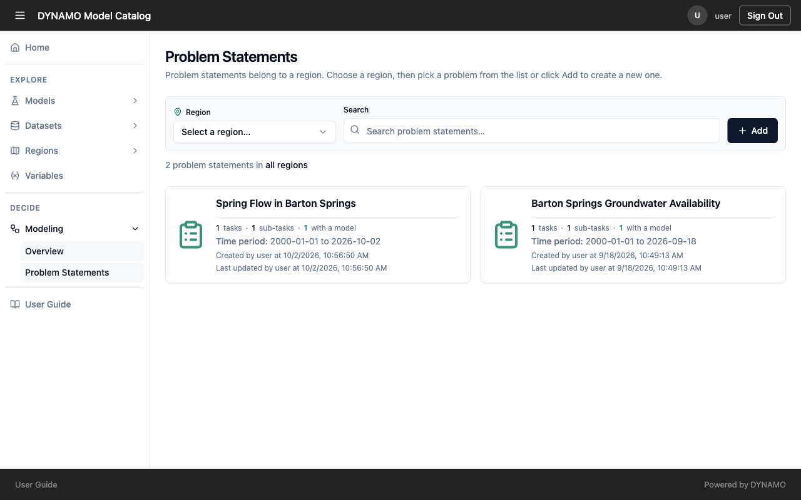
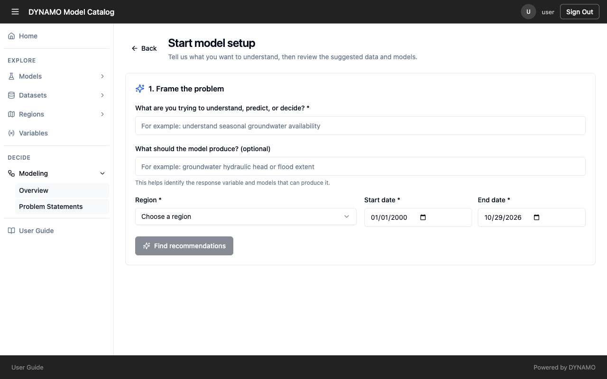

# Frame a question

Start by saying what you want to know. DYNAMO uses your answers to suggest models and data, so a clear question here saves effort in every later step.

## See what already exists

Open **Modeling → Problem Statements** to see the questions your team has already set up. Choose a **Region** to narrow the list, or search by name. Each card shows how many tasks, sub-tasks and models it has, its time period, and who last updated it. Reopen an existing one if it already covers your question, so work is not duplicated.

You must be signed in to open or create one.

## Start a new one

Select **Add**. A short form asks you to frame the problem.

1. **What are you trying to understand, predict, or decide?** (required) Write the real question in plain words, such as "understand seasonal groundwater availability". Colleagues will read this later, so write it for them.
2. **What should the model produce?** (optional) Name the result you want, such as "groundwater hydraulic head" or "flood extent". Fill this in when you can: it lets DYNAMO pick out models that produce that result. Leaving it blank gives DYNAMO less to go on.
3. **Region** (required) Choose the area your question is really about. Models and data are linked to regions, so the right region keeps out resources that do not apply. A region that is too small can leave out useful data.
4. **Start date and End date** (required) Match the window to the period you care about. Datasets declare the time they cover, and data that does not cover your period cannot answer your question.

Select **Find recommendations** to see suggested models and data. Treat the suggestions as a starting point: you review and change them, and nothing runs until you submit a run yourself.

## Organise the work

A **problem statement** is the whole question. Under it, add **tasks** for related pieces, such as one for hydrology and one for crop yield, so each stays focused while sharing the same context. Each task has a **thread**, which is the working space for choosing models and data, setting values, running and reviewing.

If something you expected is missing from the suggestions, it is often because the model or data was not described fully, not because your question is wrong. See [Why the details you enter matter](../reference/why-metadata.md).
