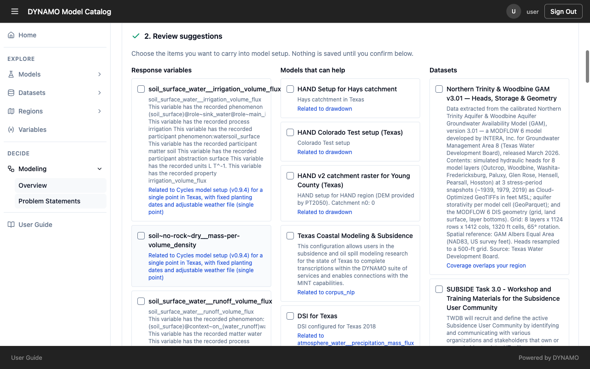
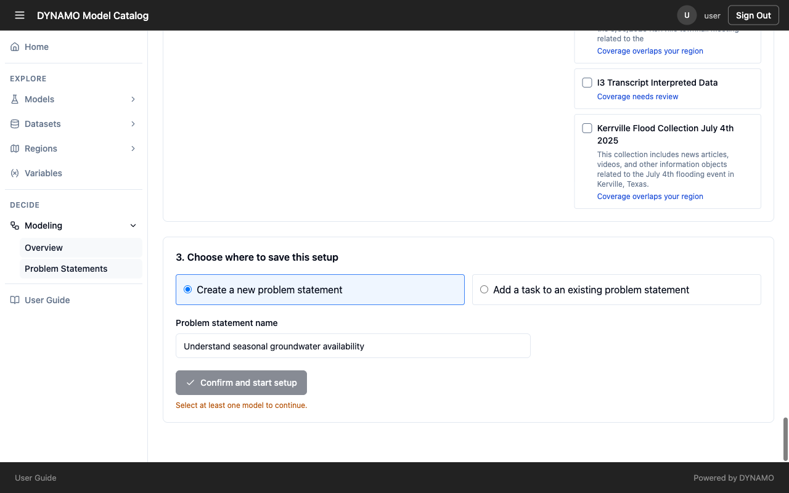

# Frame a question

Framing is the first part of the process, and it leads you into the run model wizard. You say what you want to know, DYNAMO suggests models and data that could help, you choose what to carry forward, and the wizard then takes you through the rest. A clear question here saves effort at every later step.

## See what already exists

Open **Modeling → Problem Statements** to see the questions your team has already set up. Choose a **Region** to narrow the list, or search by name. Each card shows how many tasks, sub-tasks and models it has, its time period, and who last updated it. Reopen an existing one if it already covers your question, so work is not duplicated.

You must be signed in to open or create one.

## Start a new one

Select **Add**. The first part of the form asks you to frame the problem.

1. **What are you trying to understand, predict, or decide?** (required) Write the real question in plain words, such as "understand seasonal groundwater availability". Colleagues will read this later, so write it for them.
2. **What should the model produce?** (optional) Name the result you want, such as "groundwater hydraulic head" or "flood extent". Fill this in when you can: it lets DYNAMO pick out models that produce that result.
3. **Region** (required) Choose the area your question is really about. Models and data are linked to regions, so the right region keeps out resources that do not apply. A region that is too small can leave out useful data.
4. **Start date and End date** (required) Match the window to the period you care about. Data that does not cover your period cannot answer your question.

Select **Find recommendations**.

## Review the suggestions

DYNAMO shows three lists: **Response variables** (what could be measured or predicted), **Models that can help**, and **Datasets**. Each suggestion says why it appears, for example "Related to drawdown" for a model, or "Coverage overlaps your region" for a dataset. Use those reasons to judge whether a suggestion really fits.

Tick the items you want to carry into the setup. Nothing is saved until you confirm, and nothing runs, so you can look freely. You must tick at least one model to continue. A model is the thing that will actually run, so the wizard cannot start without one.

If something you expected is missing, it is often because the model or data was not described fully, not because your question is wrong. See [Why the details you enter matter](../reference/why-metadata.md).

## Choose where to save it

Decide where this setup lives.

- **Create a new problem statement** and give it a name. Use this for a new question. The name starts as your question, so rename it if you want something shorter.
- **Add a task to an existing problem statement.** Use this when the work belongs to a question your team already has, so related work stays together.

A **problem statement** is the whole question. A **task** is one focused piece of it, such as hydrology or crop yield. Each task has its own **thread**, the working space where you run the model.

Select **Confirm and start setup**. This saves your choices and opens the run model wizard, where you [continue step by step](use-model.md).
