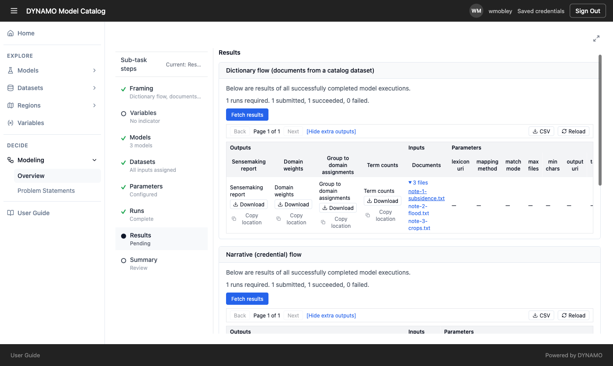

# Review results

A run that finishes is not the same as an answer you can rely on, so review the result together with how it was produced.

1. Open the **Results** step of the wizard for each model you ran. Check which outputs are available. A model that has not been run yet shows *Not run yet. Send this model's runs from the Runs step.*
2. Open **Previous runs & provenance** in the Runs step to compare earlier attempts. Compare what changed between runs, such as a dataset or a parameter, to see what caused a different result.
3. Check the context before you interpret a result: the model, the data for each input, the parameter values, and whether the run completed or failed.
4. If an output is missing or a run failed, open the detailed view for that run. It shows the stages, any error message and the files produced. Note the run's name and the message before you ask anyone for help.

## Results from a collection

When an input took a **collection**, several files read together as one input, the run's record for that input shows **N files** rather than a single file name. Select it to list the files that run read. See [Run a flow](run-a-flow.md).

## What a run keeps

Each run's record shows the files it read, the settings it used, and the outputs it produced. Where a run did not save one of these, the record says *Not recorded*. Saved credentials never appear in a run's record.

Keep the setup visible beside the result, because anyone reading your answer will need to know the region, dates, data and values behind it.
