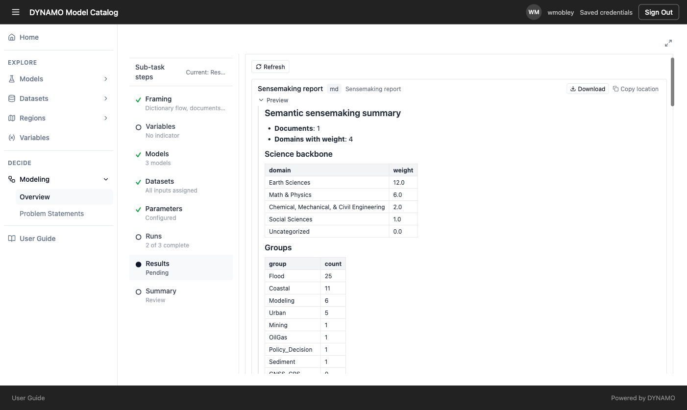

# Review results

A run that finishes is not the same as an answer you can rely on, so review the result together with how it was produced.

1. Open the **Results** step of the wizard. Each model you ran has its own **card**. Select a card's header to minimise it or open it again. The header shows its status. A model that has not been run yet shows *Not run yet. Send this model's runs from the Runs step.*
2. Read the outputs. Each output is its own block with its name, its type, **Download** and **Copy location**. **Refresh** reads the latest results from where the run saved them.
3. Open **Previous runs & provenance** in the Runs step to compare earlier attempts. Compare what changed between runs, such as a dataset or a parameter, to see what caused a different result.
4. Check the context before you interpret a result. Under **How this was made**, collapsed by default, are the data the run read and the settings it used, with those changed from their default first.
5. If an output is missing or a run failed, read the box on the card. Note the run's name and the message before you ask anyone for help.

## Preview a result

Under an output that DYNAMO stored in Tapis, **Preview** shows the start of the file in place:

- **A Markdown report** (`.md`) is shown formatted. A link in it shows the address it goes to beside its words.
- **A CSV file** shows its header and first rows as a small table. Very wide rows and very long cells are shortened.
- **A JSON file** is shown indented. A file that is cut off, very large or deeply nested is shown as it is, with a note saying why.

A preview is closed until you open it, except that a Markdown report opens by itself when the file list says it is under 100 KB. A file is read only when its preview is open, and only its first 200 KB is read; where that cuts the file short, the preview says so. If the file cannot be read, the preview says *Preview unavailable* and offers **Download**. Other kinds of file have **Download** only.

An output that is a web address is not read or previewed by DYNAMO, so that opening a result never sends your browser to another site. It has **Download**, which opens the address, and **Copy location**.

## A run that has not finished

The card says where the run is instead of showing results:

- **Waiting for your edit.** The flow is paused. Select **Go to Runs to edit and resume**.
- **Running.** The results will appear when it finishes. Use **Refresh** to check.
- **Failed.** The card shows the reason and the same **Restart** control as in the Runs step, with the same run time and publishing choices, and the same confirmation for a model run several times. After you restart, DYNAMO opens the Runs step so you can follow the new run.

## A model run many times

When a model ran more than once, its card keeps a table with one row for each run and a column for each output. The table has a column only for the settings that differ between runs; the rest are listed once above it as *Same for every run*. **CSV** downloads the table.

## Results from a collection

When an input took a **collection**, several files read together as one input, the run's record for that input shows **N files** rather than a single file name. Under **How this was made**, select it to list the files that run read. See [Run a flow](run-a-flow.md).

## What a run keeps

Each run's record shows the files it read, the settings it used, and the outputs it produced. Where a run did not save one of these, the record says *Not recorded*. Saved credentials never appear in a run's record.

Keep the setup visible beside the result, because anyone reading your answer will need to know the region, dates, data and values behind it.
