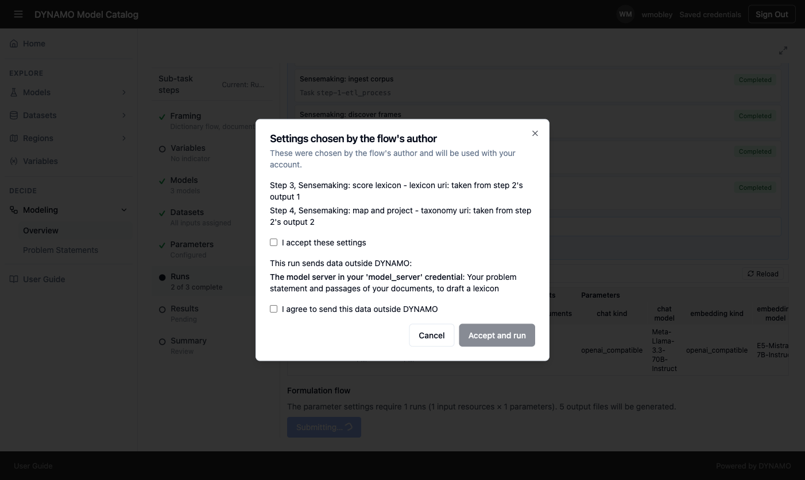
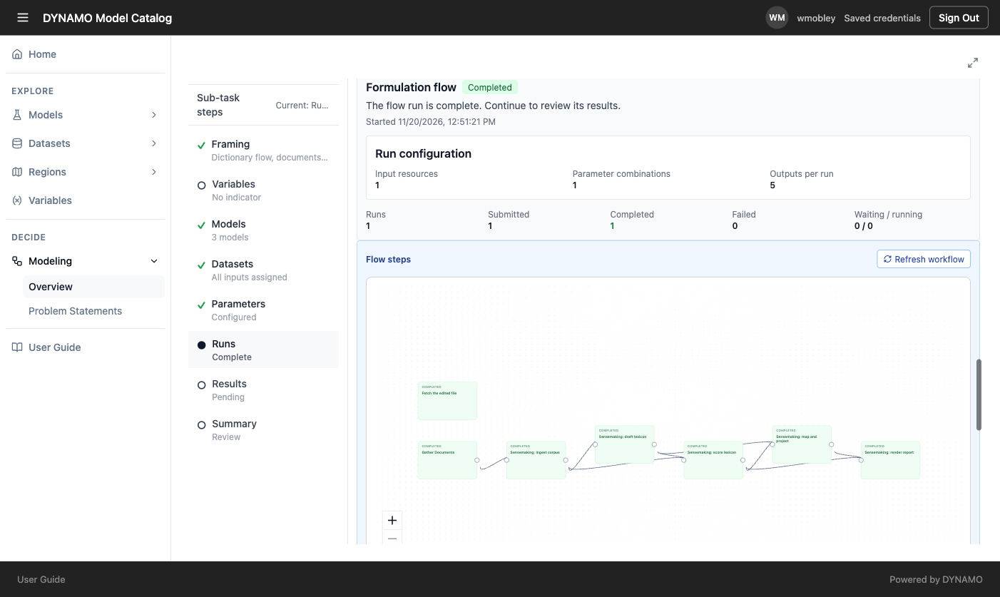
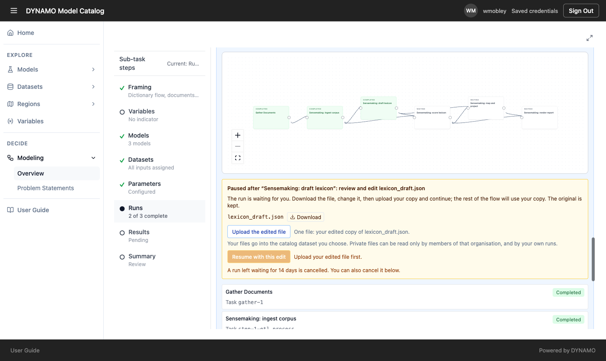

# Run a flow

A **flow** is a model made of linked steps. Each step is a piece of work, and the output of one step can feed the next. The flow's own page shows its steps, so you can see what it does before you run it.

You run a flow the same way you run a model: from a thread, on its Models, Datasets, Parameters and Runs steps. This page covers what is different about flows. You must be signed in to start a run.

## Find a flow

1. Open **Models → Browse Models**.
2. Use the **Kind** buttons to choose **All**, **Models** or **Flows**. The buttons appear only when DYNAMO can tell which configurations are flows. If you do not see them, you can still search by name.
3. Flows carry a **Flow** badge in the list. Select one to open its details.
4. Read its **Steps** section. It draws each step and the links between them. Under the drawing, each step shows its piece, who owns it, the settings the flow gives it, and where each of its inputs comes from.

A step can be marked **Not runnable for you**. That means its piece has been removed, is not visible to your account, or has not been approved for your account. A flow with such a step cannot run for you until it is fixed.

If you are signed in, **Edit as a copy** opens the flow in the flow builder as a copy. See [Build a flow and register a piece](../data-scientist/build-a-flow.md).

## Start a flow from a thread

### Models step

Choose the flow here. Flows show the **Flow** badge in the list. If a flow is not available to you, the row says why.

### Datasets step

Each input of the flow has its own card, as for a model. Two kinds of input come up:

- **An input that takes one file.** Give it one dataset.
- **An input marked "Takes a collection".** It takes several files, read together as one input. The note beside it says so: *All the files you select are read together as one input. This is one run.* You do not get one run per file. Choose the files you want, or use **Clear** to start again.

If you choose more files than an input takes, the run is refused with a message that names the input. Keep one file, or deselect the extra files, then run again.

**Upload files** on an input card adds your own files to the catalog as a new dataset, ready for that input. Choose:

- an **Organisation**. Only organisations where you can create datasets are listed.
- **Make these files public**, if you want. For a flow it is off by default, so the dataset is private. Private files can be read by members of that organisation and by your own runs.

You can upload up to 500 files at once, 2 GB in all. A flow can read private files because it runs with your access. A model cannot, so for a model the upload is always public.

### Parameters step

Review each setting. Each shows a readable title and an explanation. The form fills in the flow's default:

- **A setting with choices** is a dropdown. The explanation of the choice you pick appears under it.
- **A number** is a number box. Saving is refused, with a message, for a value outside the setting's limits.
- **A yes or no** is a tick box.
- **Anything else** is a text box.

Rarely changed settings are inside **Advanced settings**, which is closed until you open it. Settings the flow's author hid are not shown at all, and the run uses the author's value for them. A setting the author has fixed is listed under *Expert modeler has selected the following parameters* with its value, and you cannot change it. If something sends a value for a fixed or hidden setting anyway, the run is refused with *A setting is fixed or hidden by the flow*.

If a required setting has no value, the run is not started. The message says *This flow needs a setting filled in*, and names the settings. Fill them in, save, and run again.

For a model (not a flow), a parameter that has a fixed list of accepted values is a list you pick from, with its default selected. Pick more than one value to make one run for each, the same as typing several values separated by commas. A parameter with no such list stays a text box where you can type values separated by commas.

### Runs step

A flow has no Maximum run time field. Select **Send Runs** to start the run.

Before the run starts, a dialog may ask you to check something first. It can show up to three parts, in this order.

1. **Settings chosen by the flow's author.** The dialog is titled *Settings chosen by the flow's author* and lists each setting in plain words, for example a value the flow fixes, or a value taken from an earlier step's output. The run uses these settings with your account. Tick **I accept these settings**.
2. **This run sends data outside DYNAMO.** It names each outside service and what is sent to it. Tick **I agree to send this data outside DYNAMO**.
3. **Accept and run.** This button is enabled only once every box shown is ticked. **Cancel** closes the dialog without starting the run.

If the flow needs a saved credential you have not stored, the dialog is titled *Saved credentials needed*. It lists each credential and whether it is stored yet. Select **Open saved credentials**, store the credential, and then start the run again. See [Saved credentials](../saved-credentials.md).

If something blocks the run, DYNAMO shows a message with a title and the details. The most common ones are:

- *This flow has an input with no data.* Choose a dataset for that input in the Datasets step.
- *This flow is already running.* The message gives the run's name. Wait for it to finish, or cancel it, before you start another.
- *The steps and the chosen data do not agree.* The message lists the problems, such as a step that cannot take the data you chose.

## Follow a run

The **Flow steps** panel in the Runs step shows the run.

- **The step graph.** Each step is one box, with its state: *Waiting*, *Running*, *Completed*, *Failed*, *Skipped* or *Cancelled*. A step that failed shows its message under it.
- **The step list.** The same steps in order, below the graph. A step that has a task reference shows it.
- **Refresh workflow.** Fetches the latest state. DYNAMO keeps checking on the run for a while after you start it. Use **Refresh workflow** at any time to check again.
- **Cancel run.** Asks you to confirm. Select **Yes, cancel run** to stop it, or **Keep waiting** to go back. A cancelled run cannot be resumed, and for a run stopped for your edit the confirmation says so.
- **Technical identifiers.** Collapsed by default. Open it only if someone supporting you asks for the IDs.

When a run finishes, the thread says *The flow run is complete. Continue to review its results.* Continue to the **Results** step.

## When a flow pauses for your edit

Some flows stop partway through, after a step whose output needs a person to check or change it. The flow's author decides where a pause happens. A paused run shows the status **Waiting for your edit**, and its panel reads *Paused after “…”: review and edit* followed by the file name.

Nothing is lost while it waits. The original file is kept.

1. **Download the file.** Use the download button beside the file name. DYNAMO has no editor, so change the file on your own computer.
2. **Upload your edited copy.** Under **Upload the edited file**, choose the **Organisation**, choose the one file, and upload it. The upload is private. When it is ready, the panel says *Ready: …* with the catalog dataset it went to.
3. **Resume.** Select **Resume with this edit**. The button is available only after the upload is ready. The rest of the flow then uses your copy.

If your edit cannot be used, the panel shows *The last edit could not be used*, with the reason. Upload a corrected copy and resume again.

Only the person who started the run can upload the edit and resume it. Anyone else sees a line naming who can.

A run left waiting for 14 days is cancelled. The panel says so. You can also cancel it yourself with **Cancel run**.

## What a run keeps

Each run keeps a record of what it read, the settings it used, and what it produced. Open **Previous runs & provenance** in the Runs step to see these records for earlier runs. Saved credentials never appear in your threads or runs, so a run record does not show a credential's value.

## Next steps

- [Review results](results.md): read what the flow produced, including a collection input's files.
- [Troubleshooting](../troubleshooting.md): what to do when a run is refused or fails.
