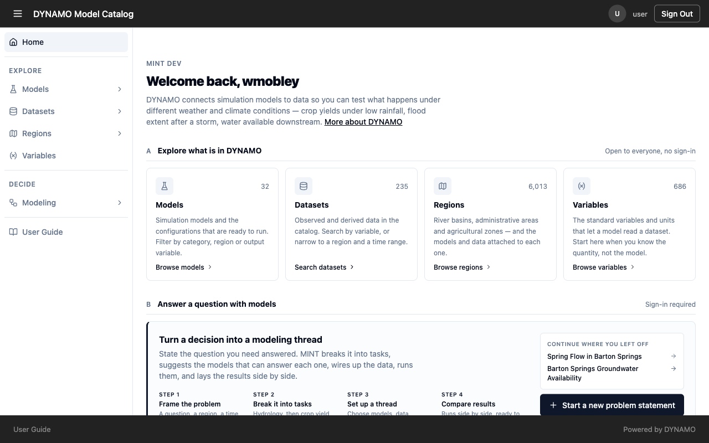

# Start here

Before you begin, write down four things: the question you want answered, the place it concerns, the time period, and what you want the model to produce, such as a water level or a flood extent. Every step later narrows the models and data to those four choices, so the clearer they are, the better the suggestions.

You can browse models, datasets, regions and variables without signing in. You need to sign in to start a modeling activity or to register anything. Use **Sign In** at the top right.

## Four words you will see everywhere

- A **model configuration** is a ready-to-run description of a model: what it needs, what it produces, and the settings you can change.
- A **dataset** is a source of data, described by what it measures, where, when, and in what file format.
- A **standard variable** is a shared name for a measured quantity, such as land surface elevation. It is how DYNAMO knows that a dataset and a model are talking about the same thing.
- A **run** is one execution of a model with the data and settings you chose.

Registering a model or a dataset in DYNAMO adds a *description*. It does not move your files or install your model. People can only find and use what has been described well.

## The home page

The home page is split into two parts. **Explore** takes you to models, datasets, regions and variables. **Decide** is where you turn a question into a modeling activity. The **User Guide** link at the bottom of the left-hand menu opens this guide.

Pick **Explore** when you want to see what exists, and **Decide** when you are ready to work on a question.
