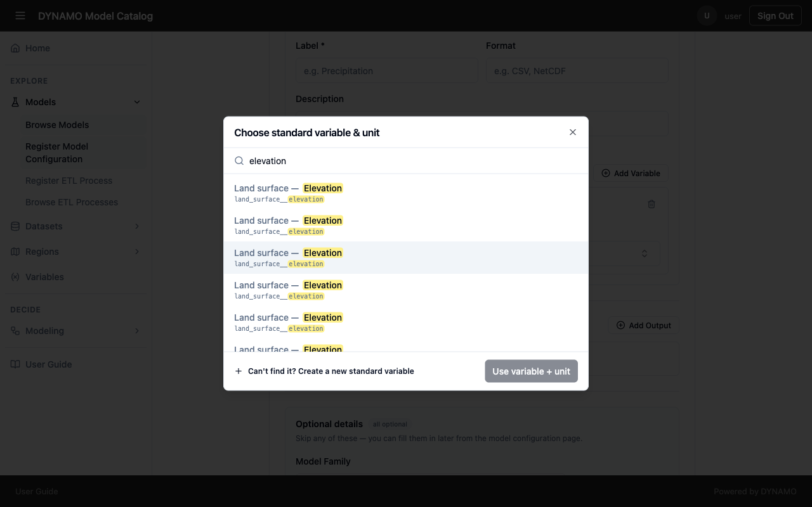
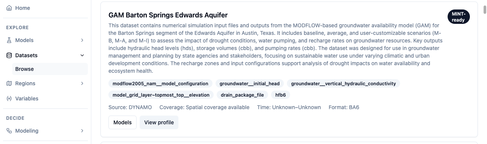

# Why the details you enter matter

DYNAMO does not open your model or your data to decide whether they fit together. It compares the *descriptions* you enter: the variable, unit, format, region and a few plain-language fields. Good descriptions are what let a facilitator find your model, and what let DYNAMO offer your data for a model's inputs. A few extra minutes on a form decides whether your work gets used.

Treat every field as answering one question for someone who has never met you.

| What you enter | The question it answers | If it is missing |
|---|---|---|
| Name and description | "Is this what I am looking for?" | People cannot tell it apart from similar models and may pick the wrong one. |
| Variable and unit on an input | "What data does this model need?" | DYNAMO cannot offer matching data, so people must search by hand. |
| Variable and unit on an output | "What question can this model answer?" | It is published, but it cannot match a modeling task. |
| Format | "Can this model read that data?" | Data with the right variable but the wrong format looks compatible, then fails. |
| Region | "Where does this apply?" | Too narrow hides a model that works anywhere. Too broad offers it where it is not valid. |
| Version | "Can I reproduce this result?" | A changed model or step quietly changes old results. |
| Model family | "Is this a version of something I know?" | Versions look like unrelated models. |

## Standard variables are the shared language

A **standard variable** is a shared name for a measured quantity, such as `land_surface__elevation`. When a dataset, a model input and a transformation use the same standard variable, DYNAMO can connect them. Free-text labels such as "DEM" or "elevation raster" cannot do this, because DYNAMO has no way to know they mean the same thing.

Choose the variable that describes what the data *is*, not what you called the file. Search for it by name, and read the unit before you confirm. If nothing fits, the picker offers "Can't find it? Create a new standard variable". Check the [Variables](../discovery.md#look-up-a-variable) page first, because a new variable that nobody else uses will not connect to anything.

## What a good record looks like

A well-described dataset shows how it all appears to a user. The description says what the data contains and what it is for. The tags are its standard variables. The source, coverage, time range and format let someone judge whether it fits without opening a file.

Aim for a record that answers a stranger's questions without them having to contact you.

## A checklist before you submit

1. Could someone who has never heard of your project tell what this is for from the name and description alone?
2. Does every input and output that matters have a variable and a unit?
3. Is the format the one the file really has?
4. Did you limit the region only if the model or data really is limited to it?
5. If this replaces an earlier version, did you change the version?
