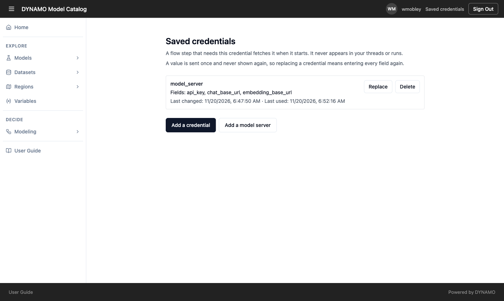

# Saved credentials

Some flow steps call an outside service with a key or password that belongs to you, such as a model server. You store that key once, under **Saved credentials**. When a step needs it, DYNAMO fetches it at the moment the step starts. The value never appears in your threads or runs.

You must be signed in to manage your credentials.

## Open Saved credentials

Select **Saved credentials** in the header, or go to `/account/credentials`.

The page lists the credentials you have saved. For each one it shows its name, its field names, when it was last changed, and when it was last used. It never shows a value.

## Add a credential

1. Select **Add a credential**.
2. Enter a **Name**. Use 1 to 64 characters: lowercase letters, digits, `-` or `_`.
3. For each value, enter a **Field name** and a **Value**.
    - A field name uses 1 to 32 characters: lowercase letters, digits or `_`. Each field name can be used only once.
    - A value cannot be empty.
    - Select **Add a field** for another field, up to 16 fields. Select **Remove** to drop a field you have not saved.
4. Select **Save**.

A credential can hold at most 4096 bytes in total, counting names and values together.

The value box is a password field. After a successful save the form clears every value, and the list shows the credential's name and field names only.

### Add a model server

**Add a model server** starts the form with the name `model_server` and three fields:

- `api_key`: the key for the server.
- `chat_base_url`: the address of the chat endpoint.
- `embedding_base_url`: the address of the embedding endpoint.

Fill in all three values, then select **Save**.

For an OpenAI-compatible model server, give the base URL including its `/v1` part, for
example `https://your-server.example/v1`. The flow adds `/chat/completions` and
`/embeddings` to it. If your server answers chat and embeddings at the same address, use
the same URL for both fields.

## Replace a credential

A value is sent once and is never shown again. So to change a credential, select **Replace** and enter every field again. The old values are replaced. The name and the field names are fixed while you replace.

## Delete a credential

Select **Delete**, then confirm in *Delete this credential?*. A flow that needs the credential will not run until you save it again.

## When you cannot change a credential

You cannot save, replace or delete a credential while one of your runs is in progress. The page then shows: *You have a run in progress. Change this credential when it has finished.* Wait for the run to finish, then try again.

If you have changed credentials many times in a short time, the page asks you to wait a few minutes and try again.

## When a flow needs a credential

If a flow needs a credential you have not stored, or that is not stored yet, DYNAMO stops before the run starts. The dialog is titled *Saved credentials needed*. It lists each credential the flow needs, and whether it is stored. Select **Open saved credentials**, add what is missing, and start the run again.

If a credential is changed after a run was planned, the run is refused with the message *A saved credential changed after this run was planned*, and asks you to press Run again.

## Next steps

- [Run a flow](facilitator/run-a-flow.md): how the run dialog and the credential check fit into a run.
- [Troubleshooting](troubleshooting.md): more messages and what to do.
